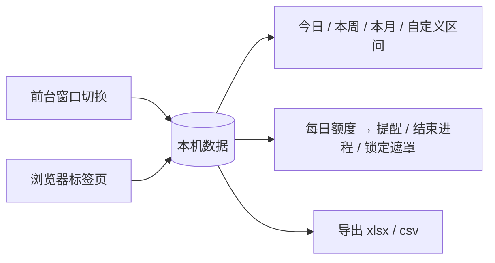

# 更矩 Guage

Windows 上统计软件与网站的用时，并为它们设下每日额度。

**统筹规划，定时定量。**

> 所有记录只留在你自己的电脑上：没有账号，没有云端，没有遥测。

## 目录

- [从哪里来](#从哪里来)
- [这一版做了什么](#这一版做了什么)
- [能力对照](#能力对照)
- [一次统计是怎样发生的](#一次统计是怎样发生的)
- [三分钟上手](#三分钟上手)
- [网页用时与浏览器扩展](#网页用时与浏览器扩展)
- [数据与隐私](#数据与隐私)
- [系统要求](#系统要求)
- [常见问题](#常见问题)
- [反馈](#反馈)
- [致谢与许可](#致谢与许可)

## 从哪里来

更矩站在一款开源工具的肩膀上：**Tai**，planshit 在 Windows 上做的用时统计程序（MIT 许可）。

它把一个朴素的问题解得干净利落——前台窗口切换一次，就记一次。于是软件用时、网页用时、应用白名单、关联进程、按进程名与 URL 正则过滤、自动分类、睡眠监测、xlsx 与 csv 导出，全都成了可读的报表。这些能力更矩**全部继承，行为保持原样**，没有为了改而改。

更矩想再往前一步：光看见不够，还得管得住；光能用不够，还得可验证。于是这一版在记录之外补上了约束，在可用之外补上了安全边界。

## 这一版做了什么

### 01 每日额度：把「少用点」变成可执行的规则

给任意程序设一个每日额度，默认 60 分钟，按分钟调整。到点有三条收场路线，任你选：

- **只提醒**：弹一次通知，不打断
- **结束进程**：先倒计时，时间走完再关闭程序
- **锁定遮罩**：全屏盖住，除了解锁什么也做不了

遮罩支持自定义密码解锁；可以禁止靠重启绕过；跨天自动重置额度，熬过零点不会白得一次重来。

### 02 休息提醒：把离开屏幕也排进计划

工作与休息循环计时，默认 25 分钟工作、5 分钟休息，可在 1 分钟到 12 小时之间调整。到点以弹窗加托盘通知打断你。

电脑睡眠再唤醒不会被静默跳过：错过的时段会被标记，并补上一次提醒——而不是从计时里悄悄消失。

### 03 安全边界：三道闸门

- **下载**：更新包只允许落在受控路径，路径越界即拒绝
- **访问**：抓站点图标只连页面自身的域名，不跟随指向内网与回环地址的重定向
- **通道**：浏览器扩展与客户端之间用令牌鉴权，令牌失效即断开

解锁密码以带盐的 PBKDF2 派生保存；同时保留对旧格式的验证，老用户升级后不会因为算法换了反而被锁在门外。

### 04 可验证的更新：签名对不上就不装

更新只从本仓库的 Releases 获取。每个发布包附带 SHA-256 与数字签名，客户端下载后先验签、再解压、最后安装。任何一步对不上，更新中止，不会把半成品铺进你的目录。

### 05 工程化：核心能自己跑起来

核心逻辑与界面分层，核心层不依赖界面即可测试。现有 13 组单元测试，覆盖时间限额、休息提醒、时长归集、导出、解压、更新包与签名校验、路径与 URL 与网络校验、密码哈希及其向后兼容。测试项目自带极简断言，不引入第三方框架，一条命令即可跑完。

## 能力对照

| 能力 | Tai | 更矩 |
| --- | :---: | :---: |
| 软件用时统计 | ✓ | ✓ |
| 网页用时（浏览器扩展） | ✓ | ✓ |
| 应用白名单 / 关联进程 | ✓ | ✓ |
| 进程名 / URL / 正则过滤 | ✓ | ✓ |
| 自动分类 | ✓ | ✓ |
| 睡眠监测 | ✓ | ✓ |
| 导出 xlsx / csv | ✓ | ✓ |
| **每日额度与锁定遮罩** | — | ✓ |
| **工作 / 休息循环提醒** | — | ✓ |
| **更新包签名校验** | — | ✓ |
| **单元测试** | — | 13 组 |

> 「—」表示原项目 README 未列出该能力，不代表它没有别的实现方式。上表只为说清这一版把力气花在了哪里。

## 一次统计是怎样发生的

数据从采集到落盘全在本机完成，中间不经过任何服务器。

## 三分钟上手

1. 到 [Releases](https://github.com/hauxu/guage/releases) 下载最新压缩包，解压到任意目录
2. 双击 `guage.exe` 启动。程序常驻托盘：双击图标打开主界面，右键唤出菜单
3. 首次运行建议以管理员身份启动——否则读不到提权进程，那部分软件不会被计入

卸载只需两步：在设置里关掉开机自启，再删除程序目录。

## 网页用时与浏览器扩展

应用用时开箱即用；网页用时需要安装一次浏览器扩展（Chrome / Edge 通用）：

1. 打开 `chrome://extensions`（Edge 为 `edge://extensions`），开启右上角的开发者模式
2. 点击「加载已解压的扩展程序」，指向 `Guage.Chrome` 目录
3. 回到客户端，在「设置 > 常规 > 功能」里打开网页统计；首页右上角出现「已连接」，配置即生效

扩展的安装细节与权限说明见 [Guage.Chrome/README.md](Guage.Chrome/README.md)。

扩展只与本机客户端通信，不上传任何数据。

## 数据与隐私

- 所有记录只存在这台电脑上，存放位置可以在设置里更改
- 没有账号体系，没有云端同步，没有遥测上报
- 只有两种情况会出网：点击检查更新时获取发布信息；开启网页统计后获取站点图标（只连接该页面的域名，不跟随指向内网与回环地址的重定向）
- 收集范围与用途详见 [隐私政策](privacy.txt)

## 系统要求

| 项目 | 要求 |
| --- | --- |
| 操作系统 | Windows 10 及以上 |
| 运行时 | .NET Framework 4.8（Win10 一般自带） |
| 浏览器 | Chrome / Edge（仅网页用时需要） |

## 常见问题

**某些程序统计不到？**

以管理员身份运行客户端。普通权限读不到提权进程，那些软件不会被计入。

**扩展装好了，首页却没显示「已连接」？**

依次确认三件事：客户端正在运行；「设置 > 常规 > 功能」里的网页统计已打开；加载扩展时选中的是 `Guage.Chrome` 目录本身。

**换电脑或换目录，数据会丢吗？**

记录都在本机。先把数据目录整体复制到新位置，再到设置里把存放位置改过去即可。

**下载的包怎么确认没被动过？**

每个发布包都附带 SHA-256 与签名，客户端安装更新时会自动校验。

## 反馈

- 缺陷与建议：[Issues](https://github.com/hauxu/guage/issues)
- 使用讨论：[Discussions](https://github.com/hauxu/guage/discussions)
- 安全问题：请勿公开提 issue，按 [安全策略](.github/SECURITY.md) 私下报告

## 致谢与许可

更矩基于 [Tai](https://github.com/planshit/Tai) 的源码重构并继续维护。界面设计与大量基础能力出自 planshit 之手，谨致谢意。

Tai 以 MIT 发布，本项目同样以 MIT 发布，原始版权声明保留在 [LICENSE](LICENSE) 中。

> 仓库名 `guage` 是 `gauge` 的拼写变体，中文名「更矩」。
