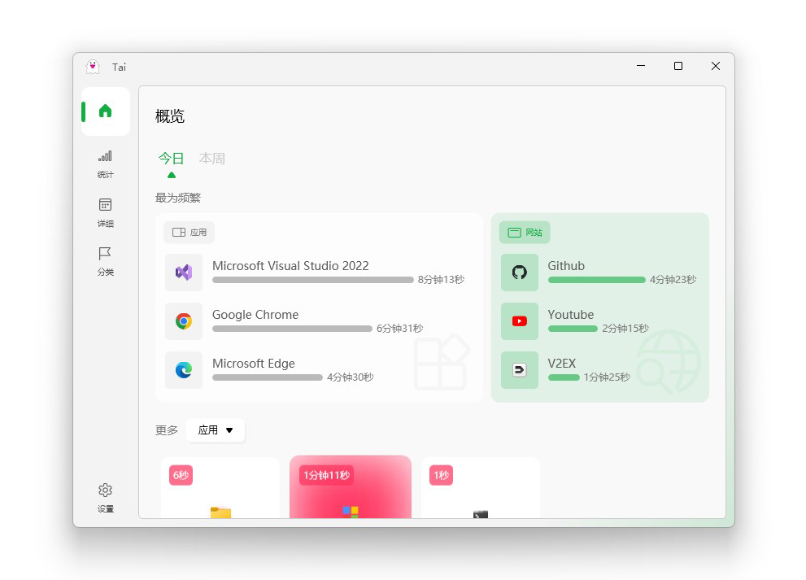

# 更矩 · Guage

**Windows 上的应用与网页用时统计。** 统筹规划，定时定量。

[](LICENSE)
[](https://github.com/hauxu/guage/releases)




> 数据全在本机：没有账号，没有云端，没有遥测。

## 功能

| 功能 | 说明 |
| --- | --- |
| 应用用时 | 按前台窗口统计，支持今日 / 本周 / 本月 / 自定义区间，可分类、可设别名 |
| 网页用时 | 配合浏览器扩展统计 http/https 页面时长（Chrome / Edge 通用） |
| 时长限制 | 给程序设每日额度：仅提醒 / 倒计时后结束进程 / 锁定遮罩；支持密码解锁、禁止重启、跨天重置 |
| 休息提醒 | 工作与休息循环计时，到点弹窗加托盘通知 |
| 过滤与白名单 | 按进程名、URL 或正则排除，也可只统计白名单里的程序 |
| 数据导出 | 导出 xlsx 或 csv |

## 下载与安装

1. 到 [Releases](https://github.com/hauxu/guage/releases) 下载最新的 `guage-x.y.z.zip`
2. 解压后运行 `guage.exe`。程序常驻托盘：双击图标打开主界面，右键出菜单

**系统要求**：Windows 10（1803 及以上）、.NET Framework 4.8（Win10 一般自带）。

**建议以管理员身份运行**：否则读不到部分提权进程，那部分软件不会被统计。

**卸载**：在设置里关掉开机自启，再删除程序目录。

## 浏览器扩展

网页用时需要安装 `Guage.Chrome` 目录里的扩展（Chrome / Edge 通用）：

1. 打开 `chrome://extensions`（Edge 用 `edge://extensions`），开启开发者模式
2. 「加载已解压的扩展程序」，选择 `Guage.Chrome` 目录
3. 在客户端 **设置 > 常规 > 功能** 里打开网页统计；首页右上角显示「已连接」即正常

扩展只连本机 `127.0.0.1`，使用令牌鉴权。端口占用时可走备用端口：

| 用途 | 主端口 | 备用端口 |
| --- | --- | --- |
| WebSocket | 8908 | 8910 / 8912 |
| 令牌 | 8909 | 8911 / 8913 |

## 数据与隐私

- 数据全部留在本机，默认位于程序目录下的 `Data`，可在设置里改位置，核心文件是 `Data\data.db`
- 没有账号，没有云端，没有遥测
- 只有两种情况会出网：点「检查更新」时拉取 Release；开启网页统计时抓取站点图标（只连该页面的域名，不跟随指向内网与回环地址的重定向）
- 隐私政策见 [privacy.txt](privacy.txt)

## 常见问题

**Q：为什么某些程序统计不到？**
用管理员身份运行客户端；普通权限读不到提权进程。

**Q：扩展装了，首页却没显示「已连接」？**
先确认客户端在运行，且 **设置 > 常规 > 功能** 里的网页统计已打开；再确认加载扩展时选的是 `Guage.Chrome` 目录本身。

**Q：怎么确认下载的包没被改过？**
每个发布包都带 `.sha256` 与 `.sha256.sig`，客户端安装更新时会验证；手动校验可用 `certutil -hashfile guage-x.y.z.zip SHA256`。

## 项目结构

```text
Core/           核心：窗口观察、计时、数据库、时长限制、休息提醒、WebSocket 服务
UI/             WPF 界面
Guage.Chrome/   浏览器扩展（Manifest V3，service worker）
Updater/        更新程序（从 GitHub Release 检查并安装更新）
GuageBug/       内部小工具（WPF 单窗口）
Tests/          零依赖控制台测试
docs/           设计说明
scripts/        图标生成与发布签名
```

## 从源码构建

用 Visual Studio 打开 `guage.sln`（需 .NET Framework 4.8 开发组件），或命令行：

```bat
MSBuild.exe guage.sln -t:Build -p:Configuration=Release -p:Platform="Any CPU"
```

产物在 `UI\bin\Release\guage.exe`。

测试是零依赖控制台工程：

```bat
MSBuild.exe guage.sln -t:Build -p:Configuration=Debug -p:Platform="Any CPU"
Tests\Guage.Tests\bin\Debug\Guage.Tests.exe
```

发布包需要一并上传 `.sha256` 与 `.sha256.sig`，用 `python scripts/sign-release.py <zip>` 生成，否则客户端不会安装更新。

## 反馈

- Bug 与建议：[Issues](https://github.com/hauxu/guage/issues)
- 讨论：[Discussions](https://github.com/hauxu/guage/discussions)

## 更新日志

见 [Releases](https://github.com/hauxu/guage/releases)。

## 致谢

界面与功能基于 [Tai](https://github.com/planshit/Tai)（MIT）修改，本项目在其基础上重构并继续维护。

## 许可

[MIT](LICENSE)

> guage 是 gauge 的拼写变体，中文名「更矩」。
