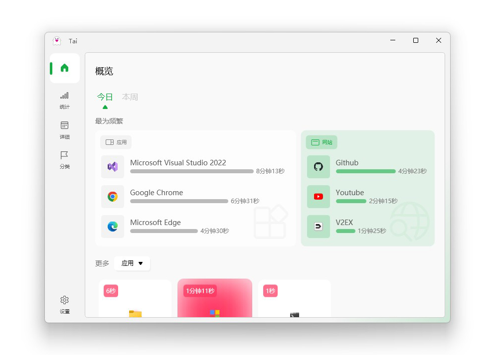

# 更矩

Windows 上的软件与网站用时统计工具。记录时间实际花在了哪，并提供使用时长限制与休息提醒。



## 环境

- Windows 10 及以上
- .NET Framework 4.8（Win10 以上通常已自带；启动没反应时先装它）
- 建议以管理员身份运行：否则读不到部分提权进程，那部分软件不会被统计

## 使用

从 Releases 下载最新的压缩包，解压后运行 `guage.exe`。程序常驻托盘：双击打开主界面，右键出菜单。

卸载：先在设置里关掉开机自启，再删除程序目录。

## 功能

- **软件用时**：按前台窗口统计，可看今日、本周、本月与自定义区间，支持分类、按安装目录自动归类、应用别名
- **网站用时**：需装配套浏览器扩展，只统计 http/https 页面
- **时长限制**：给指定程序设每日额度，到点可选仅提醒、倒计时结束后结束进程、或全屏锁定；支持密码解锁、禁止重启、当日累计与跨天重置、解锁后的重新锁定时长
- **休息提醒**：工作/休息循环计时，到点弹窗加托盘通知
- **过滤与白名单**：按进程名、URL 或正则排除，也可只统计白名单内的程序
- **关联进程**：多屏场景把几个程序绑成一组，用时同步累加
- **睡眠检测**：检测到离开自动停表
- **数据导出**：导出 xlsx 或 csv

## 浏览器扩展

网站统计需要 Chrome / Edge 扩展 **guage Sentry**：

- 扩展商店搜索安装；商店未上架时，用 Chrome 的「加载已解压的扩展程序」选 `Guage.Chrome` 目录
- 装好后到 设置 > 常规 > 功能 打开「网站浏览统计」，首页右上角显示「已连接」即正常
- 详细步骤见 `Guage.Chrome/README.md`

## 数据与隐私

数据全部留在本机，默认在程序目录下的 `Data`（可在设置里改到别处），核心是 `Data\data.db`。没有账号、没有云端、没有遥测。

程序只在两种情况下出网：

1. **检查更新**：只有你在设置里点检查更新时才发起；
2. **下载网页图标**：开启网站统计后，为记录到的站点抓 favicon。只连该页面的域名，超时 6-8 秒，不跟随到内网或回环地址的重定向。

## 从源码构建

用 Visual Studio 打开 `guage.sln` 生成，或命令行：

```bash
MSBuild.exe guage.sln -t:Build -p:Configuration=Release -p:Platform="Any CPU"
```

产物在 `UI\bin\Release\guage.exe`。单元测试是零依赖控制台工程：

```bash
MSBuild.exe Tests\Guage.Tests\Guage.Tests.csproj -t:Build -p:Configuration=Debug -p:Platform="Any CPU"
Tests\Guage.Tests\bin\Debug\Guage.Tests.exe
```

注意：`-p:Platform="Any CPU"` 里的空格在 Git Bash 下会被拆成两个参数，用 cmd 或 PowerShell 执行本行。

## 许可

见 LICENSE。统计内核源自 [Planshit/Tai](https://github.com/Planshit/Tai)，感谢原作者。
